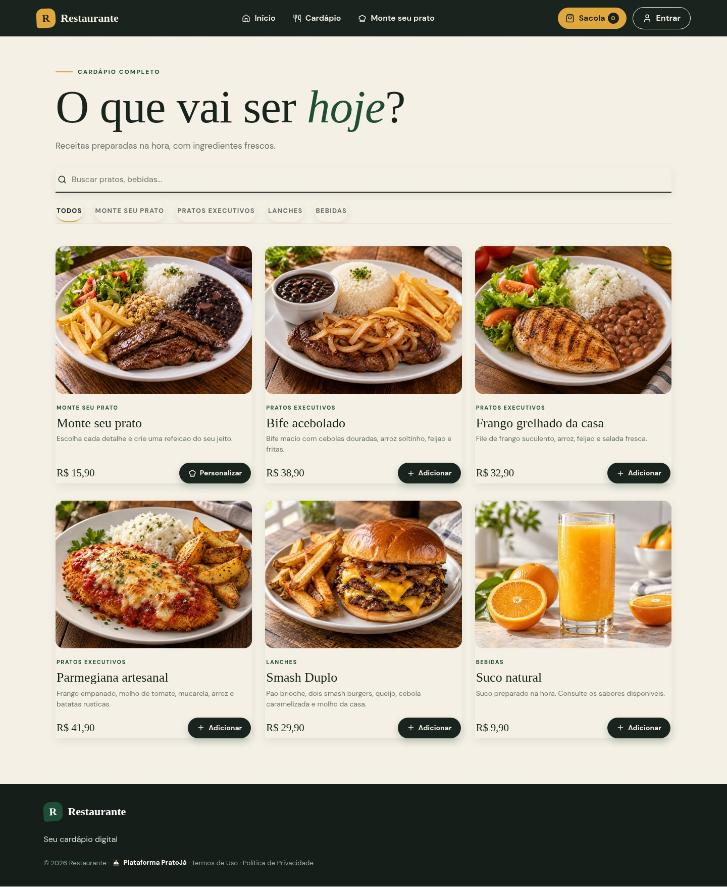
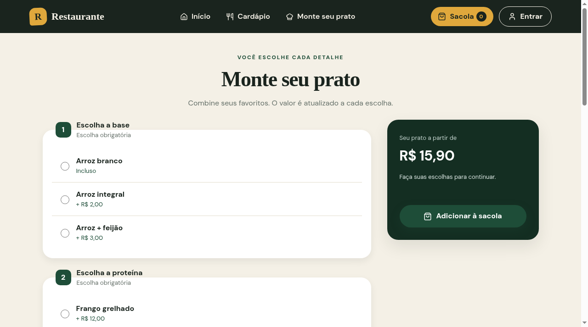

# PratoJá

Sistema de **cardápio digital e pedidos para múltiplas lojas**. Cada restaurante configura sua identidade visual, seus horários e a taxa de entrega pelo painel administrativo. A aplicação permite personalizar pratos e concluir pedidos, com acompanhamento de status e relatórios.

O back-end é um monolítico Java/Spring Boot (MVC + Thymeleaf) com isolamento de dados por loja no banco e nas consultas, migrações Flyway e testes de fluxo automatizados no CI.

## Demonstração

**Aplicação:** https://18.220.70.13.sslip.io

> A demo fica no ar continuamente em um servidor na AWS (Lightsail). Se preferir, os passos abaixo executam o projeto localmente em poucos minutos.

**Conta demo (cliente):** `cliente@pratoja.com.br` / `Cliente@123` (credencial pública de demonstração). Os dados podem ser alterados por outros visitantes. O acesso administrativo é provisionado internamente e não possui credencial pública.

## Telas

| Cardápio | Monte seu prato |
| --- | --- |
|  |  |

Capturas da [demonstração pública](https://18.220.70.13.sslip.io), com a identidade visual atual (out/2026). As imagens dos pratos na demo foram geradas por IA para fins de demonstração; em uma loja real, cada restaurante envia as fotos dos próprios pratos pelo painel.

## Sobre o projeto

O PratoJá implementa o fluxo de um pedido online: navegação no cardápio, montagem do prato com grupos de opções e adicionais, carrinho com taxa de entrega, checkout com entrega ou retirada, acompanhamento do status em tempo real, histórico, avaliação e repetição de pedido. Também inclui os painéis administrativos de loja e de plataforma.

Cada loja vive sob `/loja/{slug}` (home, cardápio, produto, monte-seu-prato, sacola, checkout, acompanhamento), com dados isolados por `store_id` em todas as consultas do back-end.

## Principais funcionalidades

Home, cardápio com busca e categorias, e página de detalhes do produto.

Monte seu prato com grupos de opções e adicionais.

Carrinho com quantidades, observações, subtotal e taxa de entrega.

Cadastro, login, recuperação de senha e perfil. Exclusão de conta pela interface (dados pessoais apagados, histórico anonimizado).

Endereços de entrega, checkout para entrega ou retirada e pagamentos simulados (PIX, cartão ou dinheiro).

Acompanhamento do pedido, histórico, repetir pedido e avaliação.

Painel ADMIN da loja: dashboard, pedidos com alteração de status, produtos, categorias, relatórios e configurações da loja (identidade visual e operacional em tela, sem deploy).

Painel da plataforma (`/platform`): criação e gestão de lojas, ativação/desativação e gestão de administradores por loja.

Termos de Uso e Política de Privacidade integrados à aplicação.

## Tecnologias

Java 21, Spring Boot (Spring MVC, Spring Security, Spring Data JPA, Bean Validation).

Thymeleaf, HTML/CSS/JavaScript (sem framework de frontend).

Flyway (migrações), H2 (demonstração local) e PostgreSQL (produção).

Maven Wrapper. CI com GitHub Actions executando os testes a cada push.

## Perfis de acesso

**Cliente (CUSTOMER):** monta pedidos, acompanha status, avalia e gerencia o próprio perfil.

**Administrador da loja (STORE_ADMIN):** gerencia cardápio, pedidos, relatórios e as configurações da própria loja (senha definida por `PRATOJA_ADMIN_PASSWORD`).

**Administrador da plataforma (PLATFORM_ADMIN):** operador da plataforma no painel `/platform`. Cria lojas, ativa/desativa e gerencia STORE_ADMINs por loja. Provisionado no boot apenas se `PRATOJA_PLATFORM_ADMIN_PASSWORD` estiver definida. Não vê dados transacionais além de métricas agregadas.

### Multitenancy

Entidades de operação (`categories`, `products`, `option_groups`, `orders`) possuem `store_id`. `users.store_id` vincula o STORE_ADMIN à sua loja.

Toda consulta é escopada por loja (`findByIdAndStore_Id` etc.). Acesso a objeto de outra loja retorna **404**.

Páginas públicas por slug em `/loja/{slug}`. Sacola em sessão por loja. Rotas antigas sem slug redirecionam 301 para a loja única ativa (com 2+ lojas ativas, `/` lista as lojas).

## Arquitetura / Estrutura

```text
src/main/java/br/com/pratoja/pratoja/
├── config/       Security, seeding e inicialização
├── domain/       Entidades JPA e tipos de domínio
├── repository/   Repositórios Spring Data
├── service/      Regras de negócio (conta, pedidos, loja, tempo real)
└── web/          Controllers MVC (loja, perfil, admin, carrinho, jurídico)
src/main/resources/
├── db/migration/ Migrações Flyway
├── templates/    Páginas Thymeleaf
└── static/       CSS, JS e imagens
```

## Como executar

```bash
./mvnw spring-boot:run        # Linux/Mac
.\mvnw.cmd spring-boot:run    # Windows
```

Acesse `http://localhost:8080`. Por padrão usa H2 em arquivo (`./data/pratoja`) com dados de demonstração. Para PostgreSQL, ative o perfil `postgres` com `DATABASE_URL`, `DATABASE_USERNAME` e `DATABASE_PASSWORD`.

Testes:

```bash
./mvnw test
```

## Variáveis de ambiente

| Variável | Uso |
|---|---|
| `DATABASE_URL` / `DATABASE_USERNAME` / `DATABASE_PASSWORD` | Conexão PostgreSQL (perfil `postgres`, utilizado em produção) |
| `PRATOJA_ADMIN_PASSWORD` | Senha do administrador da loja seed. **Obrigatória em produção**: sem ela o boot falha |
| `PRATOJA_PLATFORM_ADMIN_PASSWORD` | Provisiona o administrador da plataforma quando definida |
| `PRATOJA_DEMO_MODE` | Modo demonstração (`true`/`false`) |
| `PRATOJA_MAIL_ENABLED`, `SMTP_*`, `MAIL_FROM`, `MAIL_BASE_URL` | Envio real de e-mail (outbox). Detalhes em [docs/email-e-recuperacao-de-senha.md](docs/email-e-recuperacao-de-senha.md) |

Nenhuma credencial é versionada.

## Segurança e privacidade

Senhas com hash bcrypt (custo 12). Senhas administrativas definidas por variável de ambiente e sincronizadas a cada inicialização.

Sessão com cookie HttpOnly/SameSite e proteção CSRF em todos os formulários.

Controle de acesso por papel, isolamento por loja e checagem de titularidade de pedidos/endereços.

Consultas parametrizadas via JPA. Upload de imagens restrito a administradores e a formatos de imagem.

Sem analytics, rastreamento ou cookies além do de sessão.

Rate limiting nas rotas de recuperação de senha (detalhes em [docs/email-e-recuperacao-de-senha.md](docs/email-e-recuperacao-de-senha.md)).

## Status

Em produção em https://18.220.70.13.sslip.io (container Docker + PostgreSQL em AWS Lightsail). Multitenancy nas fases 1–5 concluído: isolamento por loja no back-end, páginas públicas por slug e painel `/platform`.

## Limitações conhecidas

Pagamento e confirmação são **simulados**. Nenhuma cobrança real é realizada.

Recuperação de senha: por padrão não há envio de e-mail (em modo demonstração o link é exibido na tela). Com `PRATOJA_MAIL_ENABLED=true` o envio é real via SMTP.

Login/cadastro ainda não têm rate limiting (apenas as rotas de recuperação).

O e-mail da conta não é editável após o cadastro.

## Avisos específicos

**Nenhuma cobrança real é realizada**: pagamento inteiramente simulado para fins de demonstração. Não informe dados reais de cartão.

## Autor

Enzo Almeida
